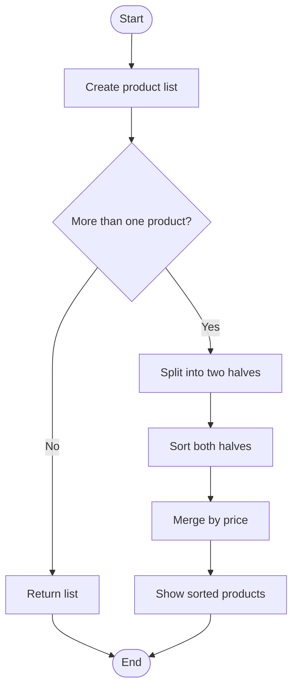

# Case Study 1: E-commerce Product Sorting Using Divide and Conquer

## Student details

- **Subject:** Data Structures
- **Unit:** 1
- **Name:** Add your name
- **Department:** Computer Engineering
- **College:** Add your college name
- **Academic year:** Add your academic year
- **Date:** Add submission date

## 1. Introduction

When we shop online, we often sort products from low price to high price or the other way around. For example, someone looking for headphones may want to compare the cheaper options first. Sorting puts the products in an order that is easier to read.

In this case study, I use a small sample product list and the Merge Sort algorithm to arrange products by price. The example shows how the Divide and Conquer method works.

## 2. Problem statement

Given a list of products with names and prices, sort the products from the lowest price to the highest price without separating a product's name from its price.

## 3. Objectives

- To understand the Divide and Conquer approach.
- To learn how Merge Sort works.
- To write a simple Python program to sort products by price.
- To check the output and discuss the algorithm's complexity.

## 4. Where this can be useful

An online shopping catalog may have many products. Sorting by price makes it easier for customers to compare items and choose something that fits their budget. This example is a simple demonstration; it does not claim to use the same code as any real shopping website.

## 5. Concept used: Divide and Conquer

Divide and Conquer solves a problem by breaking it into smaller parts, solving those parts, and joining the results.

Merge Sort works in three main steps:

1. **Divide:** Split the list into two halves.
2. **Conquer:** Sort each half by applying the same process.
3. **Combine:** Merge the two sorted halves in the correct order.

The splitting continues until each small list contains one item or no items. Such a list is already sorted.

## 6. Algorithm

1. Start with the list of products.
2. If the list has zero or one product, return it.
3. Divide the list into two halves.
4. Sort both halves using Merge Sort.
5. Compare the prices at the beginning of the two sorted halves.
6. Add the lower-priced product to the result and continue comparing.
7. Add any remaining products.
8. Display the sorted list.

### Pseudocode

```text
MERGE_SORT(products):
    if list has zero or one item:
        return list

    split list into left and right halves
    sort left half
    sort right half
    merge both sorted halves by price
    return merged list
```

## 7. Flowchart



## 8. Python program

The full program is saved as [`ecommerce_product_sorting.py`](ecommerce_product_sorting.py). It uses a list of products, where each product has a name and a price.

## 9. Sample data

| Product | Price (₹) |
|---|---:|
| Headphones | 1,499 |
| Keyboard | 899 |
| Backpack | 1,199 |
| Mouse | 499 |
| Monitor | 7,999 |

After sorting, the expected order is:

| Product | Price (₹) |
|---|---:|
| Mouse | 499 |
| Keyboard | 899 |
| Backpack | 1,199 |
| Headphones | 1,499 |
| Monitor | 7,999 |

Run the Python program to see the original list and the sorted list printed in the terminal.

## 10. Time and space complexity

For the Merge Sort implementation in this project:

| Case | Time complexity |
|---|---|
| Best case | O(n log n) |
| Average case | O(n log n) |
| Worst case | O(n log n) |

The usual list-based implementation uses **O(n) extra space** while merging. Here, `n` means the number of products.

## 11. Advantages

- It works efficiently for large lists compared with simple O(n²) sorting methods.
- Its time complexity is O(n log n) in all three cases.
- It can sort complete product records using the price field.

## 12. Limitations

- It uses extra memory to merge the lists.
- Price alone does not tell a customer which product is best.
- A real shopping website may also consider stock, rating, popularity, and other filters.

## 13. Test cases

| Test | Input | Expected result |
|---|---|---|
| 1 | Products in random order | Products sorted by ascending price |
| 2 | Products already sorted | Order remains ascending |
| 3 | One product | The same product is returned |
| 4 | Empty list | Empty result |
| 5 | Two products with equal prices | Both products remain in the result |

## 14. Result and conclusion

The program arranges the sample products from the lowest price to the highest price. This case study helped demonstrate how Merge Sort divides a problem into smaller parts and combines the results. It is a useful example of the Divide and Conquer technique.

## 15. References

- Python tutorial — data structures: https://docs.python.org/3/tutorial/datastructures.html
- CP-Algorithms — Merge Sort: https://cp-algorithms.com/sorting/merge-sort.html
- Open Data Structures: https://opendatastructures.org/

**Before submitting:** Add your own details, run the program, and make sure you can explain each step in your own words.
