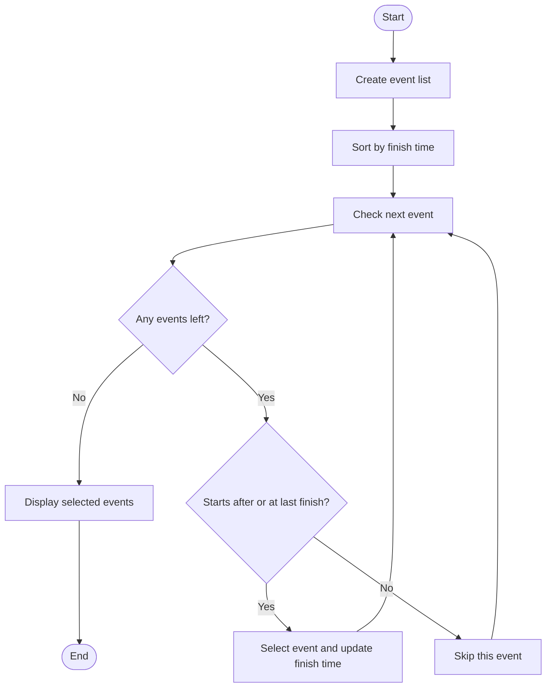

# Case Study 2: Calendar Event Selection Using a Greedy Strategy

## Student details

- **Subject:** Data Structures
- **Unit:** 1
- **Name:** Add your name
- **Department:** Computer Engineering
- **College:** Add your college name
- **Academic year:** Add your academic year
- **Date:** Add submission date

## 1. Introduction

A calendar helps us plan classes, meetings, appointments, and other activities. Sometimes two events are scheduled at the same time, so we cannot attend both. This case study looks at a simplified version of that problem.

I use the activity-selection algorithm, which is a classic example of the Greedy strategy. The goal is to select as many events as possible without overlapping.

**Note:** This is an educational example inspired by calendar scheduling. It does not describe or reproduce Google's internal Google Calendar algorithm.

## 2. Problem statement

Given several events with start and finish times, select the largest possible group of events that do not overlap. An event is allowed to start at the exact time the previous selected event finishes.

## 3. Objectives

- To understand the Greedy strategy.
- To apply the activity-selection algorithm.
- To represent events in Python.
- To show which events are selected by the algorithm.
- To study its time and space complexity.

## 4. Example from daily life

Suppose a student has a study session, a team meeting, a lab, and a club activity. Some of these may overlap. If the student can attend only one event at a time, a schedule must be selected so the chosen events do not clash.

This example uses fixed start and finish times. Real calendar apps have more features, including recurring events, time zones, reminders, meeting participants, and priorities.

## 5. Concept used: Greedy strategy

A Greedy algorithm makes a choice that looks best at the current step and then continues with the remaining problem.

For the classic activity-selection problem, the useful rule is to choose the compatible event that finishes earliest. This leaves as much time as possible for later events.

### Steps

1. Sort events by increasing finish time.
2. Select the first event.
3. Check the remaining events in that order.
4. Select an event if its start time is greater than or equal to the finish time of the last selected event.
5. Continue until every event has been checked.

This rule is optimal for the classic problem where all events have equal importance and the aim is to maximize the number of selected events. It may not be suitable when events have different priorities or values.

## 6. Pseudocode

```text
ACTIVITY_SELECTION(events):
    sort events by finish time
    selected = empty list
    last_finish = not set

    for each event:
        if last_finish is not set OR event.start >= last_finish:
            add event to selected
            last_finish = event.finish

    return selected
```

## 7. Flowchart



## 8. Python program

The full program is saved as [`calendar_activity_selection.py`](calendar_activity_selection.py). It sorts the events by finish time and prints the selected events and the events that were not selected.

The program uses simple integer times: for example, `9` means 9:00 and `10` means 10:00.

## 9. Sample data

| Event | Start | Finish |
|---|---:|---:|
| Study | 9 | 10 |
| Team meeting | 9 | 11 |
| Lab | 10 | 12 |
| Lunch appointment | 12 | 13 |
| Club activity | 11 | 14 |
| Revision | 13 | 15 |

One maximum-size compatible selection is:

| Selected event | Start | Finish |
|---|---:|---:|
| Study | 9 | 10 |
| Lab | 10 | 12 |
| Lunch appointment | 12 | 13 |
| Revision | 13 | 15 |

The program prints the exact selection it finds. An event not selected by this run is not necessarily impossible in every other possible schedule; it simply does not belong to the schedule selected by this algorithm.

## 10. Why the greedy rule works

Choosing the compatible event that finishes earliest leaves the most remaining time for later activities. For the standard activity-selection problem, this choice can be shown to lead to a maximum number of non-overlapping activities.

The result depends on the problem assumptions. If events have different priorities, need travel time, or require multiple attendees, a more advanced scheduling method may be needed.

## 11. Time and space complexity

Let `n` be the number of events.

- Sorting the events takes O(n log n) time.
- Checking the events takes O(n) time.
- Total time complexity is **O(n log n)**.
- The sorted and selected lists require **O(n)** additional space in this implementation.

## 12. Advantages

- The method is simple to understand and implement.
- It works efficiently for the classic activity-selection problem.
- It produces a group of events that do not overlap.

## 13. Limitations

- It treats every event as equally important.
- It does not manage recurring events, time zones, attendees, or reminders.
- It does not move or edit events already stored in a calendar.
- It is not Google's actual scheduling algorithm.

## 14. Test cases

| Test | Input | Expected result |
|---|---|---|
| 1 | Three events with no overlap | All three are selected |
| 2 | Several overlapping events | A maximum compatible set is selected |
| 3 | Empty list | No events selected |
| 4 | Next event starts exactly when the previous one ends | Both can be selected |
| 5 | One event | That event is selected |

## 15. Result and conclusion

The program selects non-overlapping events by checking them in order of finishing time. This demonstrates the Greedy strategy and the activity-selection problem. It is a simplified way to understand how algorithms can help with scheduling decisions.

## 16. References

- Google Calendar Help: https://support.google.com/calendar/
- CP-Algorithms — activity selection: https://cp-algorithms.com/greedy/activity-selection.html
- Open Data Structures: https://opendatastructures.org/

The Google Calendar Help page is for general calendar features; it is not evidence of Google's internal algorithm.

**Before submitting:** Add your own details, run the code, and make sure you can explain why the algorithm selects each event.
